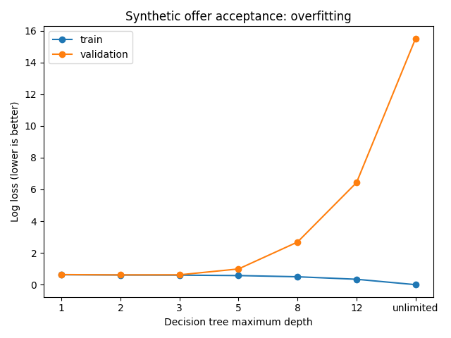

# Synthetic experiment results

Educational data only; no production efficacy claim.

| Candidate | Train log loss | Validation log loss |
|---|---:|---:|
| logistic_C_0.01 | 0.6106 | 0.6035 |
| logistic_C_0.1 | 0.6092 | 0.6021 |
| logistic_C_1 | 0.6091 | 0.6020 |
| logistic_C_10 | 0.6091 | 0.6020 |
| tree_depth_1 | 0.6238 | 0.6357 |
| tree_depth_2 | 0.6094 | 0.6146 |
| tree_depth_3 | 0.6004 | 0.6204 |
| tree_depth_5 | 0.5732 | 0.9894 |
| tree_depth_8 | 0.4971 | 2.6830 |
| tree_depth_12 | 0.3400 | 6.4268 |
| tree_depth_None | 0.0000 | 15.4994 |

Selected on validation: **logistic_C_10**.

Held-out test: {"precision": 0.5402298850574713, "recall": 0.40869565217391307, "prAuc": 0.5551806224820568, "logLoss": 0.6123549334428708}

Constant baseline test: {"precision": 0.0, "recall": 0.0, "prAuc": 0.38333333333333336, "logLoss": 0.6657280498066778}

A deeper tree can memorize training outcomes while validation loss rises. Choose complexity using validation, never test.
